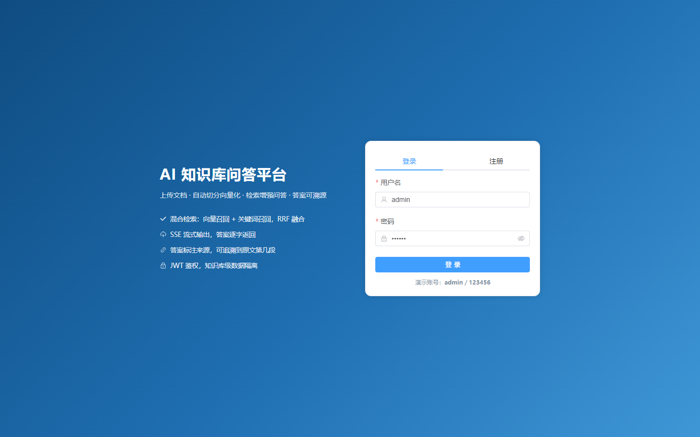

# kb-platform · 企业级 AI 知识库问答系统
（大部分代码由ai生成，上传了演示视频）
[](https://github.com/USER/kb-platform/actions/workflows/ci.yml)


> 上传文档 → 自动解析切分 → 向量化入库 → 混合检索 → 大模型生成**带出处**的回答。
> 后端基于 Spring Boot 3 + Spring AI + LangChain4j + pgvector，并提供 **MCP Server** 把知识库能力开放给其他 AI 客户端。

## 功能特性

| 能力 | 说明 |
|---|---|
| 文档 ETL | Tika 解析 PDF / Word / Excel / Markdown，LangChain4j 递归切分，pgvector 存储 |
| 混合检索 | 向量召回 + 关键词召回，RRF 融合排序，解决型号、专有名词召回差的问题 |
| 引用溯源 | 每个回答都带文件名、切片号、相似度与原文片段 |
| 多轮记忆 | Spring AI `ChatMemory` + `MessageChatMemoryAdvisor`，Redis 热存 + MySQL 冷存 + Kryo 序列化 |
| 多模型 | 千问 / DeepSeek / Kimi / OpenAI / Ollama 五个 provider，按优先级降级，简单问题走本地 |
| 工具调用 | `@Tool` + `ToolContext`，模型可在资料不足时自主再检索一次 |
| MCP Server | SSE 传输，`searchKnowledgeBase` / `knowledgeBaseStats` 两个工具，供外部 Agent 复用 |
| 流式输出 | SSE 逐字返回，前端 fetch + ReadableStream 消费 |
| 多用户隔离 | JWT 鉴权 + 知识库归属校验，越权访问返回 403 |

## 界面预览



## 系统架构

```bash
# 1. 起中间件（MySQL 需自备或 docker compose --profile with-mysql up -d）
docker compose up -d redis postgres

# 2. 配本地环境（模板不含任何真实口令）
cp src/main/resources/application-local.yml.example src/main/resources/application-local.yml

# 3. 启动
mvn spring-boot:run
```

访问 <http://localhost:8080/>，演示账号 `admin / 123456`。
想接真实模型，把环境变量配上即可（不配则自动降级为本地模拟实现，链路依然可跑通）：

```bash
export DASHSCOPE_API_KEY=sk-xxx     # 千问
export DEEPSEEK_API_KEY=sk-xxx      # 可选：第二个 provider
export KB_AI_API_KEY=sk-xxx         # 业务侧判断是否走模拟实现
```

或者容器化一键启动（把中间件和应用一起拉起）：

```bash
docker compose --profile with-mysql --profile app up -d
# → http://localhost:8080/
```

## 技术栈

| 层 | 选型 |
|---|---|
| 语言 / 框架 | Java 17、Spring Boot 3.4、Spring Security（JWT） |
| AI | Spring AI 1.0（ChatClient / Advisor / Tool / MCP）、LangChain4j（文档切分） |
| 存储 | MySQL 8（业务 + 记忆冷存）、Redis 7（缓存 + 记忆热存）、PostgreSQL 16 + pgvector（向量） |
| 文档解析 | Apache Tika 2.9 |
| 序列化 | Jackson、Kryo 5 |
| 前端 | Vue 3 + Element Plus + Vite（同仓库 [web/](web/)） |

## 目录结构

```
kb-platform/
├── src/main/java/com/example/kb/
│   ├── ai/            # 模型接入、路由、记忆、工具（Spring AI 相关都在这）
│   ├── mcp/           # MCP Server 与对外工具
│   ├── retrieval/     # 混合检索与 RRF 融合
│   ├── vector/        # pgvector 读写
│   ├── service/       # 业务编排（文档、问答、知识库）
│   ├── controller/    # REST / SSE 接口
│   └── config/        # 数据源、鉴权、线程池、配置项
├── docs/              # 模块说明、工作流程、改造记录
├── sql/  sql-pg/      # MySQL 与 PostgreSQL 建表脚本
├── tools/             # 本地 mock 大模型服务（无 Key 联调用）
└── web/               # 前端工程（Vue 3 + Vite + Element Plus），构建产物写入 src/main/resources/static
```

## 

## 启动步骤

```bash
# 1. 起三个中间件（MySQL 自动执行 sql/init.sql，PostgreSQL 自动执行 sql-pg/init.sql）
docker compose up -d

# 2. 确认三个容器都是 running
docker compose ps

# 3. 启动应用
mvn spring-boot:run
```

启动后：

- **前端页面**：<http://localhost:8080/> —— Vue 3 单页应用，登录 / 知识库 / 文档 / 问答四个界面。
  源码在同仓库的 `web/` 目录，`pnpm build` 的产物会输出到本工程的 `src/main/resources/static`
- **接口文档**：<http://localhost:8080/doc.html>
- **演示账号**：`admin / 123456`（由 `DataInitializer` 在首次启动时创建）

> 改了 `sql/init.sql` 之后必须 `docker compose down -v` 再 `up`，否则初始化脚本不会重跑。

## 配置大模型（可选，不配也能跑）

默认读取环境变量：

```bash
set KB_AI_API_KEY=sk-xxxxxxxx
set KB_AI_BASE_URL=https://dashscope.aliyuncs.com/compatible-mode/v1
set KB_AI_CHAT_MODEL=qwen-plus
set KB_AI_EMBEDDING_MODEL=text-embedding-v3

# 用 DeepSeek 也可以，Base URL 换成 https://api.deepseek.com
```

**不配 Key 会怎样**：`OpenAiCompatibleAiClient` 自动降级为本地模拟实现 ——
Embedding 用哈希向量（字面重叠的文本余弦相似度确实更高），对话返回固定占位文本并模拟逐字输出。
「上传 → 切分 → 召回 → RRF 融合 → 流式问答 → 引用来源」整条链路仍然真实执行，
只是最终答案不是模型产出的。

### 前端怎么启动

开发模式（推荐，改代码热更新）：

```powershell
cd web
pnpm install        # 首次
pnpm dev            # http://localhost:5173
```

Vite 已配好 `/api` 代理到 `http://localhost:8080`，后端换端口时用：

```powershell
$env:VITE_API_TARGET='http://localhost:8085'; pnpm dev
```

生产模式（前后端一起打成一个 jar）：

```powershell
cd web
pnpm build          # 输出到 ../kb-platform/src/main/resources/static
cd ..\kb-platform
mvn -DskipTests package
java -jar target/kb-platform-1.0.0.jar
# 访问 http://localhost:8080/
```
